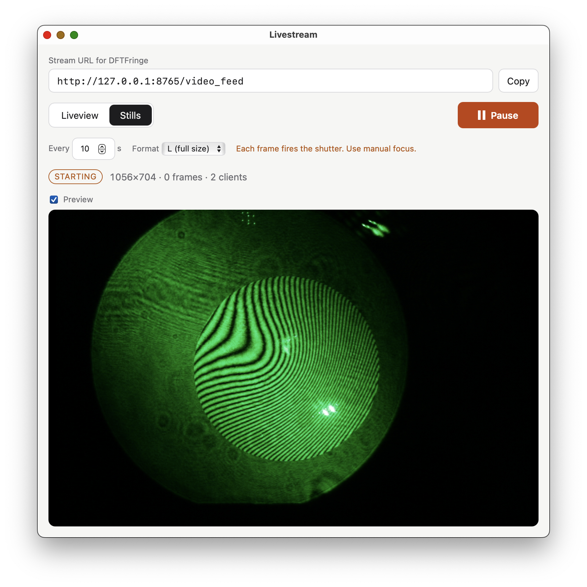
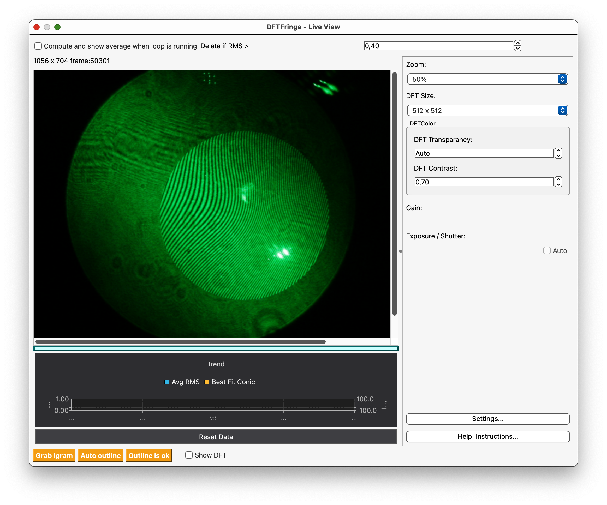

# livestream

Streams a gphoto2-supported camera (tested: Canon EOS 550D) as MJPEG over HTTP
at `http://127.0.0.1:8765/video_feed`, which DFTFringe's Live View opens as a URL.

- `app/` — desktop app for macOS and Linux (Tauri 2, Rust). Mode selector (liveview / stills),
  play/pause, live preview, status. **This is the main tool.**
- `python-poc/` — original command-line proof of concept, same stream format.

gphoto2 is not bundled: `brew install gphoto2` (macOS) or `sudo apt install gphoto2` (Linux).

## Download

Grab the latest `.dmg` (macOS, Apple Silicon) or `.AppImage` (Linux x86_64,
built on Ubuntu 22.04 so it runs on glibc 2.35+ distros) from the GitHub Releases page.

- **macOS**: the app is ad-hoc signed, not notarized. After copying it to
  Applications, run once: `xattr -dr com.apple.quarantine /Applications/Livestream.app`
  (or right-click → Open, then confirm in System Settings → Privacy & Security).
- **Linux**: `chmod +x Livestream_*.AppImage && ./Livestream_*.AppImage`.
  AppImages need FUSE 2 (`sudo apt install libfuse2`, `libfuse2t64` on Ubuntu 24.04);
  without it, run with `--appimage-extract-and-run`. The app stops GNOME's gvfs
  gphoto2 monitor before each start so it can claim the camera.

## Releasing

Bump `version` in `app/src-tauri/tauri.conf.json` (and `app/src-tauri/Cargo.toml`),
commit, then `git tag v0.1.0 && git push --tags`. The `release` workflow tests,
builds both bundles and publishes the release. "Run workflow" on the Actions tab
does a build-only dry run.

## App

    cd app
    cargo test                          # core + shell tests
    cargo run -p livestream             # run the app (dev build)

`app/core` has no dependencies and builds/tests offline. Dependency versions
are pinned exactly in `app/src-tauri/Cargo.toml`; `app/Cargo.lock` is the
audited lock (see `docs_and_plans/guides/architecture.md`).

In DFTFringe: Live view → Settings → paste the URL, press Enter.

## Modes

- **Liveview**: preview frames, 1056×704, 15–30 fps, no shutter wear.
- **Stills**: real captures (L = 5184×3456), ~1.1 s/frame at best.
  **Every frame is a shutter actuation** (550D rated ~100k). Use manual focus
  and manual exposure. Interval 1–20 s (OpenCV's FFmpeg reader times out ~30 s).
- **Pause** stops the camera; DFTFringe stays connected (the last frame is
  re-sent every 2 s). Pause DFTFringe's analysis loop too, or it re-analyses it.

## Python POC

    cd python-poc && python3 -m livestream [--mode stills] && python3 -m unittest
