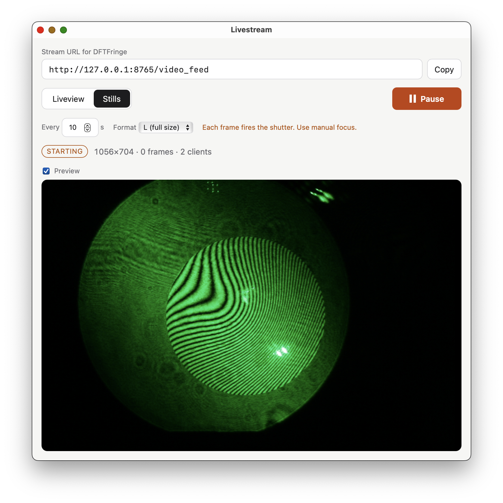
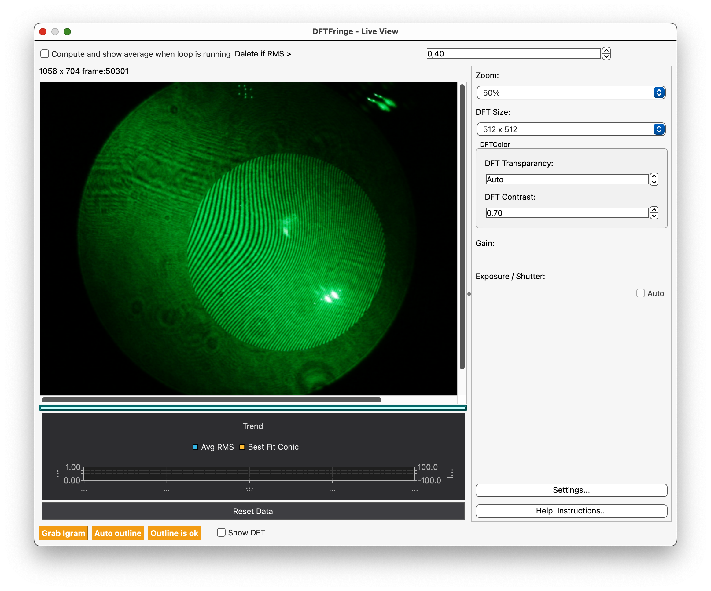

# livestream

Streams a camera as MJPEG over HTTP at `http://127.0.0.1:8765/video_feed`,
which DFTFringe's Live View opens as a URL. Three kinds of sources:

- **DSLR**: any gphoto2-supported camera (tested: Canon EOS 550D).
- **Camera**: UVC / V4L2 webcams on Linux through ffmpeg, with the camera's
  V4L2 controls (exposure, gain, white balance...) adjustable live. On macOS the
  same source uses AVFoundation (pending tests on a real camera).
- **GenICam**: USB3 Vision / GigE Vision industrial cameras (FLIR / Point Grey,
  Basler, ...) through Aravis, with exposure, gain, binning, pixel format and
  frame rate. These cameras are not UVC: OpenCV (and so DFTFringe) cannot open
  them directly on Linux.

- `app/` — desktop app for macOS and Linux (Tauri 2, Rust). Source selector,
  per-source settings, play/pause, live preview, status. **This is the main tool.**
- `python-poc/` — original command-line proof of concept, same stream format.

Capture tools are not bundled; install those for the sources you use (next section).

## System dependencies

| Source   | Debian / Ubuntu / Mint | macOS (Homebrew) |
|----------|------------------------|------------------|
| DSLR     | `sudo apt install gphoto2` | `brew install gphoto2` |
| Camera   | `sudo apt install ffmpeg` | `brew install ffmpeg` |
| GenICam  | `sudo apt install aravis-tools-cli gstreamer1.0-tools gstreamer1.0-plugins-good` | untested |

The app shows the install command when the selected source's tool is missing.

**Camera (Linux)**: the user must be able to open `/dev/video*` (desktop
sessions usually grant it; otherwise `sudo usermod -aG video $USER` and log in
again). MJPG modes are passed through untouched; other formats (YUYV, H264...)
are re-encoded to JPEG.

**GenICam**:

1. `arv-tool-0.8` (no arguments) must list the camera **without sudo**. If it
   only works as root, USB permissions are missing: the vendor SDK installers
   (Spinnaker, pylon) add udev rules; re-run that step, then log out and in.
2. Close other camera software (SpinView, pylon Viewer, arv-viewer) before
   pressing Play: USB3 Vision gives one program control of the camera at a time.
3. Settings are applied when the stream starts, so changing one restarts the
   stream (~1–2 s). "camera" leaves a setting as the camera currently has it.
4. Incomplete or dropped frames on USB3: raise the USB buffer limit with
   `echo 1000 | sudo tee /sys/module/usbcore/parameters/usbfs_memory_mb`
   (until reboot).
5. Supported pixel formats: Mono8, Mono16, RGB8, BGR8 (Bayer formats are not
   offered yet).

## Download

Grab the latest `.dmg` (macOS, Apple Silicon) or `.AppImage` (Linux x86_64,
built on Ubuntu 22.04 so it runs on glibc 2.35+ distros) from the GitHub Releases page.

- **macOS**: the app is ad-hoc signed, not notarized. After copying it to
  Applications, run once: `xattr -dr com.apple.quarantine /Applications/Livestream.app`
  (or right-click → Open, then confirm in System Settings → Privacy & Security).
- **Linux**: `chmod +x Livestream_*.AppImage && ./Livestream_*.AppImage`.
  AppImages need FUSE 2 (`sudo apt install libfuse2`, `libfuse2t64` on Ubuntu 24.04);
  without it, run with `--appimage-extract-and-run`. The app stops GNOME's gvfs
  gphoto2 monitor before each start so it can claim the camera.

## Releasing

Bump `version` in `app/src-tauri/tauri.conf.json` (and `app/src-tauri/Cargo.toml`,
`app/core/Cargo.toml`, `app/package.json`),
commit, then `git tag v0.1.0 && git push --tags`. The `release` workflow tests,
builds both bundles and publishes the release. "Run workflow" on the Actions tab
does a build-only dry run.

## App

    cd app
    cargo test                          # core + shell tests
    npm run test:ui                     # UI model tests (node --test, no install needed)
    cargo run -p livestream             # run the app (dev build)

`app/core` has no dependencies and builds/tests offline. Dependency versions
are pinned exactly in `app/src-tauri/Cargo.toml`; `app/Cargo.lock` is the
audited lock (see `docs_and_plans/guides/architecture.md`).

In DFTFringe: Live view → Settings → paste the URL, press Enter.

## DSLR modes

- **Liveview**: preview frames, 1056×704, 15–30 fps, no shutter wear.
- **Stills**: real captures (L = 5184×3456), ~1.1 s/frame at best.
  **Every frame is a shutter actuation** (550D rated ~100k). Use manual focus
  and manual exposure. Interval 1–20 s (OpenCV's FFmpeg reader times out ~30 s).
- **Save frame** writes the current frame to the Desktop as
  `livestream-<date>_<time>.jpg`, byte-for-byte (full size + EXIF in stills mode).
- **Pause** stops the camera; DFTFringe stays connected (the last frame is
  re-sent every 2 s). Pause DFTFringe's analysis loop too, or it re-analyses it.

## Real-device tests

Ignored by default; run on Linux:

    cd app/core
    LIVESTREAM_V4L2_DEVICE=/dev/video0 cargo test --test v4l2_device -- --ignored --test-threads=1
    LIVESTREAM_ARAVIS_CAMERA=<arv-tool id> cargo test --test aravis_camera -- --ignored

The Aravis test also runs against Aravis' simulator (`arv-fake-gv-camera-0.8
-i 127.0.0.1`, camera `Aravis-Fake-GV01`) on a loopback-only network.

## Python POC

    cd python-poc && python3 -m livestream [--mode stills] && python3 -m unittest

## DFTFringe tip: "Grab Igram" does nothing on macOS

DFTFringe saves grabbed frames to its "Path to igrams to import", which
defaults to `.` — that is `/` for an app opened from Finder, so the save fails
silently. Set it in DFTFringe: Settings → Igram → "Import interferogram
configuration (what hot key "i" does)" → pick a writable folder.
